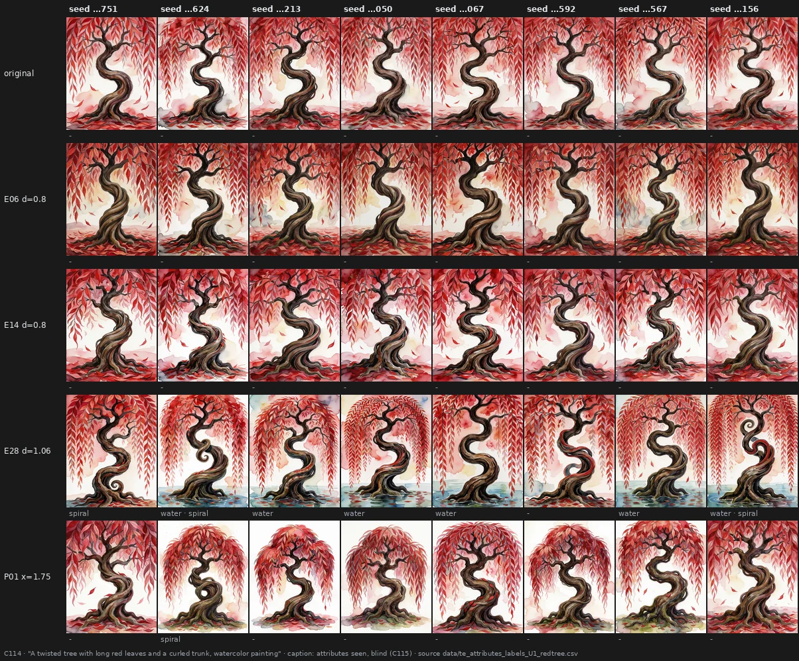

# An edit as a switch — the right dose, the same change at every seed, and what it turns on and off

> **Holds** · 2567 renders · 17 prompts · pre-registered 2026-10-22 to 2026-10-29
> [← all results](README.md#what-holds-and-what-does-not)

> **The direction I'm chasing.** Page 31 left me with an edit that has a look of its own. For a tool I need more: if I
> write "a photo of a tree" and the model always gives me the same tree, an edit should give me *another* tree, and
> give it to me at every seed. My suspicion was that the edits I had were simply not pushed hard enough to show it.
>
> **What would kill it.** A plain prompt that already varies a lot with the seed; an edit whose change goes a different
> way at every seed; a dose that breaks the picture before the change shows; a change that holds only on the prompts I
> tuned it on.
>
> **Where we are.** Half of my idea was wrong: the model does *not* always draw the same thing, and the less the prompt
> says, the more the seed decides. The other half holds, blind and on prompts I had never seen: at the right dose an
> edit changes the picture the same way at every seed, more than a change of seed moves it. And that change is not a
> blur: it switches precise things on and off. Copper eyes go, a pond appears, the art-deco gold leaves the blade for
> the background. The right dose is narrow, and I found it by eye.

## In two minutes

First I tried something gentler than one layer pushed hard: four layers nudged a little. I expected the change to be
cleaner and more coherent across subjects. It wasn't, and the nudge itself was too small: to change the picture as
much as one layer does, the presets needed twice the dose I had planned. What I did see: the change of a preset carries
from my comic portraits to a rally car or a leaf.

Then my idea about seeds. On the rally car, the plain picture looked the same at every seed, while some presets
changed the car the same way at every seed. So I asked Krea-2 for "Photo of a tree", the vaguest prompt I could think
of. It gave me eight different trees: the most seed-dependent prompt of the whole project. Then I wrote four prompts
that describe a subject and leave the setting free. The helmet and the axe came out almost identical at every seed;
the blue tree and the flying car didn't.


On those four prompts, judged blind with all eight seeds side by side, the change of an edit repeated: E28 made the
alien axe more organic and red-eyed at every seed. But changing the seed alone still looked as big a change to me as
the edits did. Most of the doses were small, half of what I would later find right.


So I pushed. Four doses for four edits on two prompts. The blind cards made no sense for this: what I needed was to see
every row and say "higher", "right", "too much", "broken". I marked them by eye. The window is narrow and it was the
same on both prompts: E06 and E14 at about 0.8, E28 at 1.06, P01 somewhere between 1.4 and 2.1. One step past it, the
helmet becomes a black figurine or a cartoon devil, the same at every seed, and no longer a helmet.


The numbers agree with the marks and warn about themselves: at the dose I marked right, E06, E14 and E28 already move
the picture 1.3 to 5 times as far as a change of seed. Past it they keep "agreeing across seeds" more and more, because
every seed leaves the prompt in the same way. Consistency alone would have picked the wrong dose.


Then the real test. Claude wrote three prompts in the style of my examples, a subject with a colour and a style, and
didn't tell me what they were: I saw them for the first time on the blind cards. At the doses I had chosen, the
change repeated at every seed in 10 of 12 cases, against none for the mixed cards, and by DINOv2 it moved the picture
further than a change of seed in 11 of 12.


Then I looked again and saw what my "everything kept" answers had missed. The robot's copper eyes were gone under two
edits, at every seed. So I labelled every picture again, one at a time, with one question per detail, without knowing
which edit made it. Claude had written down 16 predictions from the sheets; 15 held. An edit switches things: it
**adds** (E28 puts a pond under the tree and big pupils in the robot's eyes), it **replaces** (E14 swaps the copper
eyes for black ones), it **moves** (P01 takes "clay" off the robot and makes it a second little figure; E06 and P01 take
the art-deco gold off the dagger and put it on a panel behind it).


## The verdict

**Overturned** (C109): four light layers are more coherent than one pushed hard (-0.08). **Holds** (C109): a light
preset's change carries across style domains (+0.38). **Overturned** (C111, C112): a vague prompt gives the same
picture at every seed ("Photo of a tree" 0.475, the largest spread measured; 2 of 4 prompts). **Holds** (C112, C114):
an edit changes a prompt's pictures the same way at every seed, on prompts never seen (0.75 against 0.00).
**Overturned** (C112): at half the right dose an edit changes the picture more than a change of seed (0.79 against
1.00). **Open** (C113): each edit has a narrow window, the same on two subjects, found by eye. **Holds** (C114): at the
window dose an edit moves the picture further than a change of seed, by DINOv2 (11 of 12). **Overturned** (C114,
C115): at the window dose an edit keeps every stated attribute. **Holds** (C115): an edit switches nameable attributes
on or off at almost every seed, adding, replacing or moving them (15 of 16 predictions).

## Why I might be wrong

**One observer, who proposed every hypothesis.** All the blind labels are mine. I wrote the four prompts of C112. I knew
the C113 sheets. I recognised the control cards in C112 and C114 ("the same pictures, reshuffled"), and said so in my
notes.

**The window was found without a blind test.** C113 started blind and I stopped it: shown mixed cards of broken pictures
I couldn't answer anything useful. The marks that set the doses are mine, with the conditions in front of me. C114 is
the blind check of those doses, on three prompts, one card per edit and prompt.

**The attribute test checks a reading, it doesn't replicate it.** Claude's 16 predictions came from the same 120
pictures I then labelled. What C115 shows is that the reading doesn't depend on knowing which edit made a picture; it
says nothing about new pictures. And I had seen the sheets before. One question was also clarified during the pass (on
the robot, the eyes are the robot's, not the small figure's); some early robot answers may have counted the figure.

**My first "kept" answers were wrong.** In C114 I answered "subject, colour and style are all there" for every card,
including the controls. The copper eyes were gone under two edits. I corrected three labels afterwards; the
correction is in a separate file and the original stands (pitfall 96).

**The eye and DINOv2 disagree about the seed.** By eye a change of seed is always "a lot", because the background
changes even where the object doesn't (the helmet: 0.056 by DINOv2). By DINOv2 the edits move the object further.
Both are reported; neither is the truth about "how much".

**Doses chosen on two subjects, one exploratory tree.** The C112 doses came from an unregistered run on one odd tree,
and P01's dose in C114 (1.75) was interpolated, never rendered before. Three to four prompts per test, 8 seeds, one
model.

## The data

### Four light layers instead of one

C109 drew twelve presets of four MLP layers each, sign random, nominal +-0.30 per layer (P01-P06 from layers 7-24,
P07-P12 from 1-34), and calibrated each on eight subjects to a DINOv2 distance of 0.25, like C105. 84 of 96 pairs
reached it; the median strength was about twice the nominal (+-0.60 per layer). Cards showed every subject of one
preset at one seed, before and after, with three questions (content, style, and whether the change was the same kind
on the comic portraits and on the other pictures).

| rule | value | verdict |
|---|---|---|
| 0, null cards, content | 0.00 (n 4) | valid |
| 1, presets minus single layers (E14, E26), content | 0.42 (n 24) - 0.50 (n 4) = -0.08 | no difference |
| 2, across domains, presets minus null | 0.50 - 0.13 = +0.38 | carries across domains |

Coherent at both seeds: P05, P06, P12; at neither: P03, P07, P10. My notes: P06 "highlighted expressions" at both seeds,
P01 "a synthesis of the subject", P09 "more realism". Details in [`docs/te_light_presets_result.md`](https://github.com/aledelpho/diffusion-models-weight-steering-report/blob/0f3279e559535d35afef9b0fda1d3051587c8402/docs/te_light_presets_result.md).

### The same picture at every seed

C111 ("Photo of a tree", 8 test seeds, eight edits calibrated to DINOv2 0.25 on two other seeds; 8 of 8 reached, gate
pixel-identical). Rule 1: median pairwise DINOv2 distance of the plain trees 0.475, bar 0.15, "the seeds already vary".
For reference, the C109 subjects at four seeds: 0.057 (lotus canoe) to 0.178 (rally). The displacements of an edit
barely shared a direction across seeds (mean cosine 0.057 against 0.009 for different edits at different seeds). The
blind pass of C111 was not run: I had seen the pictures with their file names.

An exploratory run outside the pre-registration, which I asked for after seeing C111 (`Benchmark_te_tree_2`, "a photo of
a tall torted tree with large leaves", six of the eight doses halved), gave the opposite picture: the plain tree the same
at 8 seeds, E28 at 1.06 moving it onto a park lawn at 8 of 8. That run is where the next hypothesis came from, and it
counts for nothing else.

C112 (four prompts I wrote, 8 seeds, eight edits at the exploratory doses, 292 renders, four gates pixel-identical):

| prompt | plain spread (DINOv2) |
|---|---|
| Cartoon evil helmet with black metal and a big red gemstone | 0.056 |
| A short alien axe with a weird shaped blade | 0.094 |
| A concept yellow flying car | 0.277 |
| A curved tree with large blue leaves | 0.383 |

Rule 1, at most 0.15 in at least 3 of 4: 2 of 4, not supported. Details in `data/te_settings_dino_tests.csv` and
[`docs/te_settings_result.md`](https://github.com/aledelpho/diffusion-models-weight-steering-report/blob/0f3279e559535d35afef9b0fda1d3051587c8402/docs/te_settings_result.md).

### The same change at every seed

C112's blind page (amendment 2: two rows of eight, before above and after below, same column same seed; two plain
questions) had 32 edit cards, 8 null cards (a different edit at each seed), 4 seed cards (the plain picture at another
seed) and 4 repeats.

| rule | value | verdict |
|---|---|---|
| 0, null cards "the same way" | 0.00 (n 8) | valid |
| 1b, "how much", E28 and P01 against seed cards | 0.79 (n 8) against 1.00 (n 4) | no more than a change of seed |
| 2, "the same way", E28 and P01 against null | 0.56 (n 8) against 0.00 | repeats across seeds |

E28 carried it: the same way at all 8 seeds on the blue tree and the axe, at most on the helmet and the car, and the
most shared DINOv2 direction on all four prompts (0.31, 0.23, 0.36, 0.14 against nulls of -0.02 to 0.04). All eight
edits together: 0.38 (n 32). Test-retest: amount 4 of 4, same way 2 of 4.

### A narrow window

C113 took E06, E14, E28 and P01 to three doses above C112's on the blue tree and the helmet (192 new renders, 80 reused,
gates pixel-identical). After the first cards I asked to drop the blind pass and mark the full sheets instead (amendment
2, before any label was exported). My marks, identical on both prompts:

| edit | level 1 | level 2 | level 3 | level 4 |
|---|---|---|---|---|
| E06 | 0.4 higher | **0.8 right** | 1.2 too strong ("not much lower") | 1.6 broken |
| E14 | 0.4 higher | **0.8 right** | 1.2 broken | 1.6 broken |
| E28 | **1.06 right** | 1.59 too strong ("a touch") | 2.12 too strong | 2.65 too strong |
| P01 | 0.71 higher | 1.41 higher | 2.12 broken | 2.83 broken |

DINOv2 at the doses marked right, distance from plain over the plain seed spread and the mean cosine across seeds:
E06 1.33 and 0.32 on the tree, 4.96 and 0.58 on the helmet; E14 1.37 and 0.41, 3.20 and 0.52; E28 1.85 and 0.31, 1.93 and
0.36; P01 at 1.41 0.50 and 0.02, 1.21 and 0.21. Past the window the cosine keeps rising (E06 on the helmet: 0.10, 0.58,
0.68, 0.76) while the pictures stop being helmets (pitfall 95). Details in [`docs/te_dose2_result.md`](https://github.com/aledelpho/diffusion-models-weight-steering-report/blob/0f3279e559535d35afef9b0fda1d3051587c8402/docs/te_dose2_result.md).

### New prompts

C114 (123 renders, three gates pixel-identical): three prompts written by Claude and kept from me until the blind page,
E06 0.8, E14 0.8, E28 1.06 and P01 1.75, 8 seeds; 12 edit cards, 6 null, 3 seed, 3 repeats.

| rule | value | verdict |
|---|---|---|
| 0, null "the same way" | 0.00 (n 6) | valid |
| 1, edit cards against null | 0.75 (n 12) against 0.00 | repeats across seeds on unseen prompts |
| 2, subject, colour and style kept, all or most | 12 of 12 (10 of 12 after corrections) | passes on its wording |
| 3, DINOv2 distance at least the plain seed spread | 11 of 12 | supported |

Per cell, "the same way": "all" in 8, "most" in 2 (tree P01, robot E06), "each its own" in 2 (dagger E14, dagger E28).
Amount by eye: edits 0.89, nulls 0.94, seed cards 1.00. The three plain prompts barely vary with the seed (0.046, 0.137,
0.078). Details in [`docs/te_unseen_result.md`](https://github.com/aledelpho/diffusion-models-weight-steering-report/blob/0f3279e559535d35afef9b0fda1d3051587c8402/docs/te_unseen_result.md).



### What it turns on and off

C115 relabelled C114's 120 pictures, one per card at full size, in random order with the edit hidden, plus 4 repeats per
prompt: four yes / no / not sure questions per prompt. Count of "yes" over 8 seeds:

| prompt, attribute | plain | E06 0.8 | E14 0.8 | E28 1.06 | P01 1.75 |
|---|---|---|---|---|---|
| robot, copper eyes | 8 | 8 | 0 | 8 | 0 |
| robot, clay | 8 | 8 | 8 | 8 | 0 |
| robot, a second figure | 0 | 0 | 0 | 0 | 8 |
| robot, big black pupils | 0 | 7 | 8 | 8 | 3 |
| tree, water at the base | 0 | 0 | 0 | 6 | 0 |
| tree, a spiral in the trunk | 0 | 0 | 0 | 3 | 1 |
| tree, red leaves (control) | 8 | 8 | 8 | 8 | 8 |
| tree, watercolour (control) | 8 | 8 | 8 | 8 | 8 |
| dagger, golden decorations on the dagger | 8 | 8 | 8 | 8 | 4 |
| dagger, an art-deco panel behind | 0 | 8 | 1 | 4 | 8 |
| dagger, dark background | 0 | 8 | 0 | 5 | 7 |
| dagger, upright and centred | 2 | 8 | 3 | 3 | 7 |

Rule 1: 15 of 16 predictions confirmed (the spiral under E28, 3 of 8, is the miss). Rule 2: no change of 5 or more that
was not predicted. Test-retest 48 of 48. The same edit does different things on different subjects: E06 gives the
robot pupils and the dagger a panel, and on the tree changes nothing that was asked. Details in
[`docs/te_attributes_result.md`](https://github.com/aledelpho/diffusion-models-weight-steering-report/blob/0f3279e559535d35afef9b0fda1d3051587c8402/docs/te_attributes_result.md).

### Reproducing this

```yaml
model:
  checkpoint: krea2_turbo_bf16.safetensors
  weight_dtype: default
  sha256: not recorded — the file is outside the repository
sampling:
  sampler: euler_ancestral
  steps: 9
  cfg: 1.0
  denoise: 1.0
  scheduler: simple
  resolution: 1024x1280
  vae: qwen_image_vae.safetensors
  text_encoder: qwen3vl_4b_bf16.safetensors (CLIPLoader type krea2)
tuner:
  node: Krea2ConditioningPush (tools/comfyui_krea2_condpush), variant file; conditionings encoded with the edit applied through the Arthemy Krea-2 CLIP tuner in Real Value mode
  version: not recorded — the node is in this repository
  mode: one layer's MLP (gate, up, down) of the text encoder, weight x (1 + d) (E05, E06, E14, E26, E28); C109 presets of four MLP layers at +-0.30 x strength (P01-P12)
prompts:
  files: [data/te_light_presets_plan.csv, data/te_tree_plan.csv, data/te_tree_2_plan.csv, data/te_settings_plan.csv, data/te_dose2_plan.csv, data/te_unseen_plan.csv]
  ids: [C109 subjects D1 E2 O4 G5 S1 C4 P2 LN, T1_tree, S1_bluetree, S2_alienaxe, S3_evilhelmet, S4_flyingcar, U1_redtree, U2_dagger, U3_robot]
seeds: [2645751, 3316624, 1414213, 1732050, 2236067, 3141592, 1234567, 5772156, 1618033, 2718281]
conditions:
  - name: C109, twelve four-layer presets, calibrated per subject on DINOv2 0.25
    dose: per subject, data/te_light_presets_strengths.csv
    measured_D: data/te_light_presets_metrics.csv
  - name: C111, E05 E06 E14 E26 E28 P01 P06 P10, calibrated on DINOv2 0.25
    dose: data/te_tree_strengths.csv
    measured_D: data/te_tree_metrics.csv
  - name: C112, the same eight at fixed doses (E05 0.28, E06 0.4, E14 0.4, E26 0.53, E28 1.06, P01 0.71, P06 0.84, P10 1.0)
    dose: fixed, data/te_settings_plan.csv
    measured_D: data/te_settings_metrics.csv
  - name: C113, E06 E14 E28 P01 at four doses each
    dose: data/te_dose2_dino.csv
    measured_D: data/te_dose2_dino.csv
  - name: C114, E06 0.8, E14 0.8, E28 1.06, P01 1.75
    dose: fixed, data/te_unseen_plan.csv
    measured_D: data/te_unseen_dino.csv
outputs:
  folders: [benchmark_te_light_presets, benchmark_te_tree, Benchmark_te_tree_2 (exploratory), benchmark_te_settings, benchmark_te_dose2, benchmark_te_unseen]
  manifests: [data/te_light_presets_cal_plan.csv, data/te_light_presets_plan.csv, data/te_tree_cal_plan.csv, data/te_tree_plan.csv, data/te_tree_2_plan.csv, data/te_settings_plan.csv, data/te_dose2_plan.csv, data/te_unseen_plan.csv]
analysis:
  scripts: [experiments/te_light_presets.py, experiments/te_tree.py, experiments/te_tree_2.py, experiments/te_settings.py, experiments/te_dose2.py, experiments/te_dose2_marks_page.py, experiments/te_unseen.py, experiments/te_attributes.py, experiments/eye_grid_page.py]
  produces: data/te_light_presets_tests.csv, data/te_tree_dino_tests.csv, data/te_settings_dino_tests.csv, data/te_settings_tests.csv, data/te_dose2_dino.csv, data/te_unseen_dino.csv, data/te_unseen_tests.csv, data/te_attributes_tests.csv
```

## Provenance

* Renders: C109 (1732, of which 1450 calibration), C111 (153, of which 80 calibration), exploratory tree (73), C112 (292), C113 (194), C114 (123).
  C113 reused 80 renders of C112; C115 made no renders and relabelled C114's.
* **Pre-registrations:** [`docs/prereg_te_light_presets.md`](https://github.com/aledelpho/diffusion-models-weight-steering-report/blob/0f3279e559535d35afef9b0fda1d3051587c8402/docs/prereg_te_light_presets.md) (+ amendment 1), [`docs/prereg_te_tree.md`](https://github.com/aledelpho/diffusion-models-weight-steering-report/blob/0f3279e559535d35afef9b0fda1d3051587c8402/docs/prereg_te_tree.md) (+ amendment 1),
  [`docs/prereg_te_settings.md`](https://github.com/aledelpho/diffusion-models-weight-steering-report/blob/0f3279e559535d35afef9b0fda1d3051587c8402/docs/prereg_te_settings.md) (+ amendments 1-2), [`docs/prereg_te_dose2.md`](https://github.com/aledelpho/diffusion-models-weight-steering-report/blob/0f3279e559535d35afef9b0fda1d3051587c8402/docs/prereg_te_dose2.md) (+ amendments 1-2),
  [`docs/prereg_te_unseen.md`](https://github.com/aledelpho/diffusion-models-weight-steering-report/blob/0f3279e559535d35afef9b0fda1d3051587c8402/docs/prereg_te_unseen.md), [`docs/prereg_te_attributes.md`](https://github.com/aledelpho/diffusion-models-weight-steering-report/blob/0f3279e559535d35afef9b0fda1d3051587c8402/docs/prereg_te_attributes.md) (+ clarifications during labelling).
* **Result documents:** [`docs/te_light_presets_result.md`](https://github.com/aledelpho/diffusion-models-weight-steering-report/blob/0f3279e559535d35afef9b0fda1d3051587c8402/docs/te_light_presets_result.md), [`docs/te_settings_result.md`](https://github.com/aledelpho/diffusion-models-weight-steering-report/blob/0f3279e559535d35afef9b0fda1d3051587c8402/docs/te_settings_result.md), [`docs/te_dose2_result.md`](https://github.com/aledelpho/diffusion-models-weight-steering-report/blob/0f3279e559535d35afef9b0fda1d3051587c8402/docs/te_dose2_result.md),
  [`docs/te_unseen_result.md`](https://github.com/aledelpho/diffusion-models-weight-steering-report/blob/0f3279e559535d35afef9b0fda1d3051587c8402/docs/te_unseen_result.md), [`docs/te_attributes_result.md`](https://github.com/aledelpho/diffusion-models-weight-steering-report/blob/0f3279e559535d35afef9b0fda1d3051587c8402/docs/te_attributes_result.md).
* **Data:** `data/te_light_presets_tests.csv`, `data/te_light_presets_labels_full.csv`, `data/te_tree_dino_tests.csv`,
  `data/te_settings_key.csv`, `data/te_settings_labels.csv`, `data/te_settings_tests.csv`, `data/te_dose2_dino.csv`,
  `data/te_dose2_marks.csv`, `data/te_unseen_key.csv`, `data/te_unseen_labels.csv`,
  `data/te_unseen_labels_corrections.csv`, `data/te_unseen_tests.csv`, `data/te_attributes_key.csv`,
  `data/te_attributes_labels_U1_redtree.csv`, `data/te_attributes_labels_U2_dagger.csv`,
  `data/te_attributes_labels_U3_robot.csv`, `data/te_attributes_tests.csv`.
* **Labels and keys** were committed in the order the protocols require: key before labels, labels as downloaded before
  any count; the three C114 corrections in a separate file after the rules. All labels and marks are Alessandro's.
* **Pitfalls:** 95 (DINOv2 consistency rising past the window), 96 (one question for several attributes).
